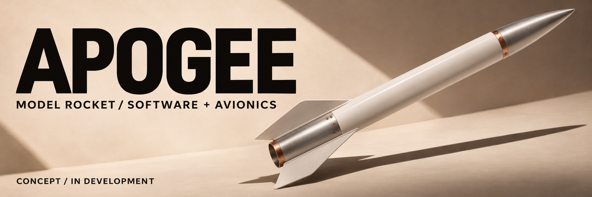
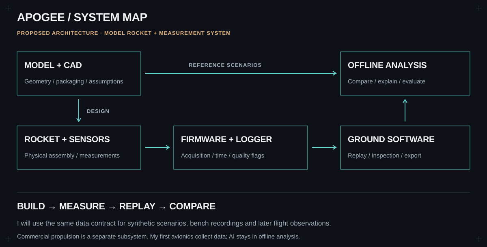

# APOGEE

**My solo hardware + software project · planning and requirements**

Concept art for my planned model rocket.

I'm developing **APOGEE** as an instrumented model-rocket project that connects mechanical design, electronics and software. I want to follow a measurement from the sensor through my firmware and into the ground tool, then compare the result with the model behind it.

My scope is a model rocket using a **certified commercial motor**, with my own work focused on modelling, airframe design, avionics packaging, firmware and analysis. I will use simulation and a sensor test bench to evaluate the system before flight.

**[Architecture](docs/architecture/README.md)** · **[Roadmap](docs/roadmap/README.md)** · **[Requirements](docs/requirements/README.md)** · **[Design decisions](docs/decisions/README.md)**

## The system I'm designing

| Hardware and physical design | Software and data |
| :--- | :--- |
| Model-rocket geometry, CAD and mass properties | Reproducible modelling and simulation comparisons |
| Avionics packaging, sensor selection and bench assembly | C/C++ acquisition firmware, timestamps and health reporting |
| Electrical interfaces and power assumptions | Ground software for inspection, replay and export |
| Fit checks, assembly records and measured bench behaviour | Offline analysis, with any AI evaluated against a baseline |

I will begin with a narrow path from measurement to analysis. Wireless telemetry, a custom PCB and AI are possible extensions; I will add them only when I can define their purpose and evaluate the result. My initial avionics will record observations, with offline analysis separate from flight-critical control.

## Current status

I have written the initial project brief, subsystem plans and milestone structure. **The vehicle, flight system and analysis tools are not built yet; I have no bench or flight results to report.** Sensor selection, controller selection, packaging, budget and flight configuration remain open decisions.

## My first milestone

I will define a beginner-appropriate model-rocket concept, document its constraints and compare feasible controller/sensor combinations. In parallel, I will define a sensor-data format and build a replay tool using synthetic recordings, including malformed and incomplete records.

I will complete this milestone with:

- A model-rocket concept and avionics packaging sketch.
- A hardware shortlist with documented tradeoffs.
- A data contract with units, timestamps and quality flags.
- A reproducible replay demo and parser tests.

The next milestone will connect the same data contract to real bench measurements. I'm using [OpenRocket](https://openrocket.info/features.html) as a starting reference for model-rocketry design and simulation, and I will document the assumptions in any models I write myself.

## Project map

| Area | What I am defining |
| :--- | :--- |
| [Requirements](docs/requirements/README.md) | First-version behaviour and acceptance criteria |
| [Architecture](docs/architecture/README.md) | Subsystems, responsibilities and interfaces |
| [Roadmap](docs/roadmap/README.md) | Milestones and the evidence needed to complete them |
| [Modelling](simulation/README.md) | Reference scenarios, assumptions and sensitivity comparisons |
| [Mechanical design](mechanical/README.md) | CAD, packaging, drawings, mass properties and fit checks |
| [Avionics](hardware/README.md) | Sensors, controller, power and bench measurements |
| [Firmware](firmware/README.md) | Acquisition, recording, health flags and host tests |
| [Ground software](ground-station/README.md) | Parsing, replay, inspection and export |
| [Data contracts](data/README.md) | Units, timestamps, provenance and recording formats |
| [Analysis and AI](analysis/README.md) | Offline methods, baseline comparisons and failure examples |
| [Verification](verification/README.md) | Planned checks and supporting evidence |
| [Parts and budget](procurement/README.md) | Available resources and spending decisions |
| [Design decisions](docs/decisions/README.md) | Alternatives, tradeoffs and open choices |
| [Coding track](learning/README.md) | C/C++ and Python exercises tied to the system |
| [Project notebook](docs/README.md) | Documentation structure and working conventions |
| [Build journal](docs/journal/README.md) | Implementation notes and results as the work progresses |

**Eren Arikan · [My GitHub](https://github.com/erudaperu)**
