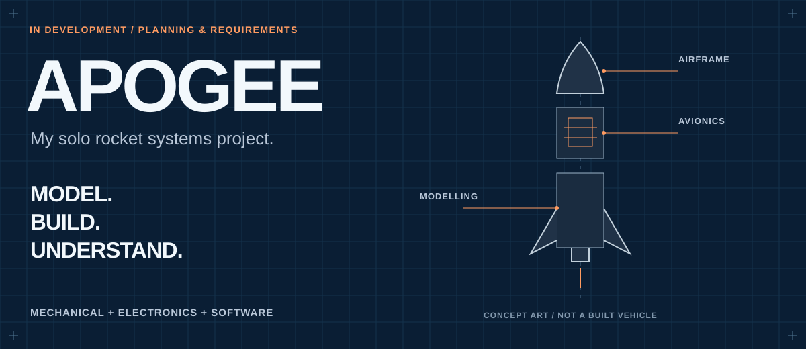

# APOGEE

**My solo hardware + software project · in progress, starting with planning and requirements.**

I want to build my own instrumented model rocket and understand the whole system: how I model it, design the physical assembly, collect measurements, write the firmware and make the data useful. I'm starting with simulation and a sensor test bench so I can build the hardware and software around the same evidence.

**APOGEE is my working title.** The scope below is my starting proposal. I still need to choose the budget, tools, components and eventual flight configuration. For a later model-rocket flight, I plan to use a certified commercial motor while focusing my own design work on the airframe, packaging, electronics and software.

**[My roadmap](docs/roadmap/README.md)** · **[System architecture](docs/architecture/README.md)** · **[Open decisions](docs/decisions/README.md)** · **[Build journal](docs/journal/README.md)**

## What I'm working toward

| Hardware and physical design | Software and data |
| :--- | :--- |
| Model-rocket geometry, CAD and mass properties | Reproducible modelling and simulation comparisons |
| Avionics packaging, sensor selection and bench assembly | C/C++ acquisition firmware, timestamps and health reporting |
| Documented electrical interfaces and power assumptions | Ground software for inspection, replay and export |
| Fit checks, assembly records and measured bench behaviour | Offline analysis, with any AI evaluated against a baseline |

I want the result to be more than a launch video. I want someone to be able to follow a measurement from the sensor through my firmware and into the ground tool, then understand where it agrees with the model and where it does not.

## Where I am now

| Work | Status |
| :--- | :--- |
| Project brief, subsystem plans and milestone structure | Written — initial planning draft |
| Budget, equipment inventory and component selection | Open |
| Simulation, CAD, electronics and firmware | Planned |
| Ground station and analysis tools | Planned |
| Bench measurements and flight results | Not performed |

The illustration above is concept art. This repository currently contains my engineering plan, not a completed vehicle or runnable flight system.

## My first milestone

I will create a small synthetic sensor recording, define its units and quality flags, and build a replay tool that handles both valid and broken records. Alongside that, I will compare feasible controller/sensor combinations and sketch the avionics packaging.

I will call that milestone complete when I can publish a reproducible demo, parser tests, a justified hardware shortlist and a packaging concept. The next milestone will connect the same data contract to real bench measurements.

## My project map

| Area | What I am defining here |
| :--- | :--- |
| [Project notebook](docs/README.md) | How I organize the work and record evidence |
| [Requirements](docs/requirements/README.md) | What the first version must do and how I will check it |
| [Architecture](docs/architecture/README.md) | Subsystems, responsibilities and interfaces |
| [Roadmap](docs/roadmap/README.md) | Milestones, exit evidence and my first work session |
| [Modelling](simulation/README.md) | Reference scenarios, assumptions and sensitivity comparisons |
| [Mechanical design](mechanical/README.md) | CAD, packaging, drawings, mass properties and fit checks |
| [Avionics](hardware/README.md) | Sensors, controller, power and bench measurements |
| [Firmware](firmware/README.md) | Acquisition, recording, health flags and host tests |
| [Ground software](ground-station/README.md) | Parsing, replay, inspection and export |
| [Data contracts](data/README.md) | Units, timestamps, provenance and recording formats |
| [Analysis and AI](analysis/README.md) | Offline methods, baseline comparisons and failure examples |
| [Verification](verification/README.md) | Planned checks and the evidence I need before making a claim |
| [Decisions](docs/decisions/README.md) | Alternatives, tradeoffs and choices still open |
| [Build journal](docs/journal/README.md) | What I attempted, learned and completed |

## How I will build it

I will start with a narrow, testable path and expand it as the results justify it. Wireless telemetry, a custom PCB and AI are possible extensions. I will keep them tied to a clear need and a way to measure whether they help.

I'm using [OpenRocket](https://openrocket.info/features.html) as a starting reference for model-rocketry design and simulation. I'll document the assumptions and differences in any models I write myself. My initial avionics will collect observations; offline analysis will stay separate from flight-critical control.

**Eren Arikan · [My GitHub](https://github.com/erudaperu)**
